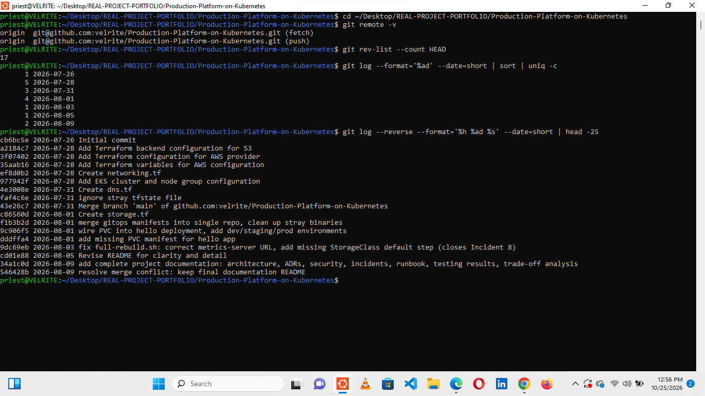
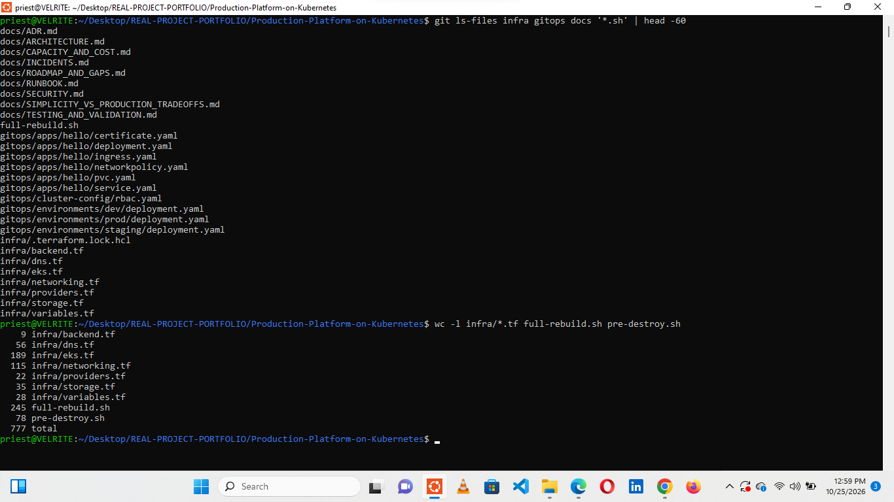
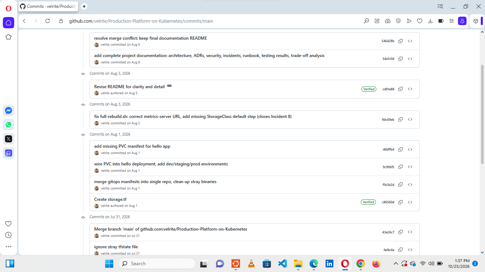
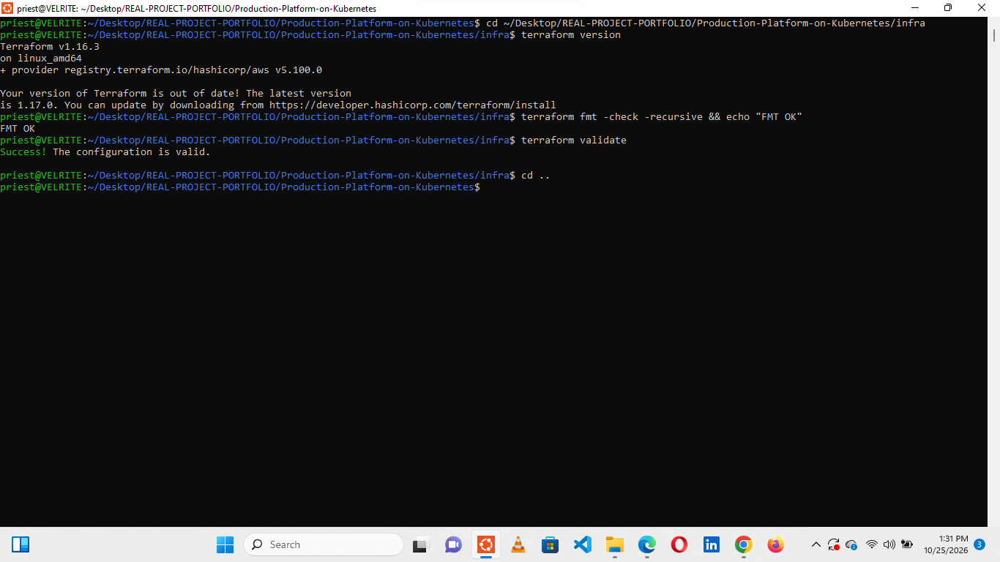
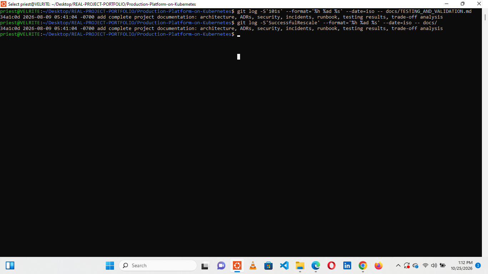
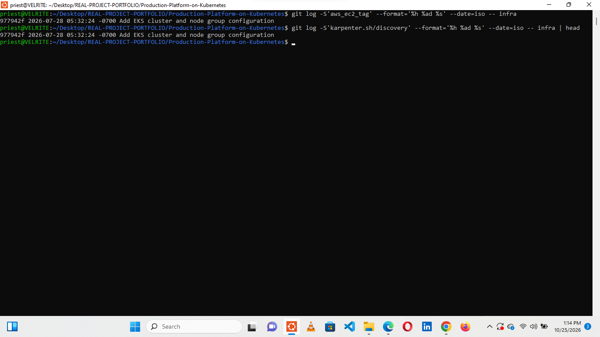
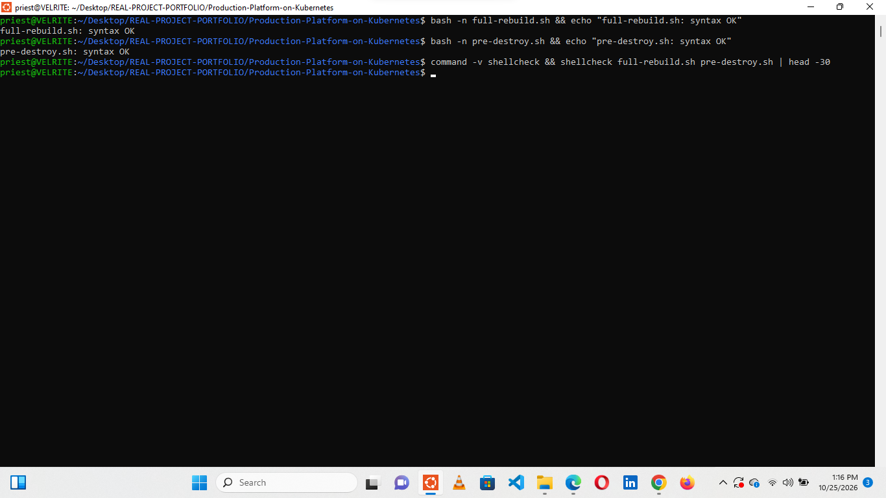

# Production Platform on Kubernetes: Three-AZ EKS, GitOps, and What Broke

I built this to answer one question with recorded output instead of claims: can one engineer provision a production-shaped Kubernetes platform from code, operate it, watch it fail, and tear it down without leaving billing resources behind?

**Status:** built, tested and destroyed between 2026-07-26 and 2026-08-09. The AWS Free Plan credits then ran out and the account was closed (reactivation deadline 2026-12-03), so nothing here can be run live. This README rests on repository evidence and on terminal output transcribed at test time. Anything not proven is labelled that way, including in the Terraform-side claims.

**Labels:** `VERIFIED` observed in real terminal output at build time · `PARTIAL` · `NOT VERIFIED` · `NOT BUILT`

This is not an application project. The workload is stock nginx. The platform around it is the subject.

---

## Engineering Problem

Getting an application onto Kubernetes once is easy. The hard part is repeatability and recovery: rebuild the whole thing from code, deploy from Git, scale it, survive a lost node, and tear it down cleanly. Most of what went wrong here happened at the boundary between tools that each believe they own the system.

---

## Architecture

~~~
engineer
  | terraform apply                       | git push
  v                                       v
Terraform --> AWS (VPC, EKS, IAM,       GitHub: gitops/
              Route53, EBS CSI)              |  watched
                                             v
VPC, 3 AZs, one NAT gateway per AZ        ArgoCD (automated, prune, selfHeal)
  private subnets: EKS v1.35                 |
    system node group  2 x t3.small          v
    Karpenter nodes    Bottlerocket       hello app: default, dev, staging, prod
    NGINX Ingress <-- cert-manager (private CA)
    ExternalDNS --> Route53 private zone
    HPA + metrics-server, EBS CSI
  public subnets: NLB, NAT gateways
~~~

| Layer | What is used |
|---|---|
| Infrastructure | Terraform, S3 state (versioned, native locking), 3-AZ VPC, EKS v1.35 |
| Nodes | 2 static t3.small system nodes, Karpenter (Bottlerocket) for the rest, NodePool capped at 20 vCPU |
| Delivery | ArgoCD, four Applications (`hello`, `hello-dev`, `hello-staging`, `hello-prod`) |
| Traffic | NGINX Ingress behind an AWS NLB, TLS from a private CA via cert-manager |
| DNS | ExternalDNS writing to a private Route53 zone `platform.internal` |
| Scaling | HPA on CPU (2 to 10 replicas), Karpenter for nodes |
| Security | per-component IAM roles via Pod Identity, EKS Access Entries, RBAC role, NetworkPolicy objects, Pod Security labels |

**The rule that explains most incidents:** Terraform owns what exists in AWS, ArgoCD owns what runs in Kubernetes, and controllers inside the cluster create real AWS resources (load balancers, DNS records, EC2 instances) that Terraform never tracks.

---

## The Failure That Shaped the Platform

Karpenter launched six real EC2 instances. `describe-instances` showed all six `running`. `kubectl get nodes` showed none of them, and six pods stayed Pending. ([INCIDENTS.md](docs/INCIDENTS.md), Incident 4)

**Cause (as understood).** With `authentication_mode = "API"`, an access entry for the node role grants `system:nodes` only. AL2023's bootstrap also needs `system:bootstrappers`, which Access Entries cannot grant. The root cause follows documented behaviour and what I observed; I did not prove it by reading node logs.

**First fix failed.** Moving the cluster back to `API_AND_CONFIG_MAP` was rejected by AWS: the transition is one-way.

**Fix.** Switched the Karpenter node class to Bottlerocket and added an `EC2_LINUX` access entry. Six new nodes joined and were Ready in 47 to 53 seconds.

**What it changed.** A one-way setting chosen early became a design constraint later. I now test node join on every OS or AMI change.

---

## Reliability Evidence

Results were transcribed from terminal output at test time into [TESTING_AND_VALIDATION.md](docs/TESTING_AND_VALIDATION.md). They are not screenshots of the live cluster.

| Scenario | Outcome | Caveat |
|---|---|---|
| Node terminated | 2/2 pods Ready in **101 s** on a newly provisioned node | both replicas landed on the same new node (no anti-affinity) |
| Rolling update under traffic | **0 non-200 of 18** requests | small sample; each request paid a TLS handshake |
| HPA under load | scaled **2 to 6 to 4** (`SuccessfulRescale` events) | target lowered to 10% to force an event; at 50% CPU peaked at 49% and correctly did not scale |
| Karpenter scale-up | **6** nodeclaims, 6 instances, nodes Ready in 47 to 53 s | scale-down (consolidation) not watched end to end |
| Private CA TLS | Certificate Ready; `curl` without `-k` failed with an untrusted-issuer error | that error is the correct result for a private root |
| ExternalDNS | records created, in-cluster lookup resolved | records live outside Terraform state |
| Latency load test | **invalid, discarded** | every worker failed; likely a stale hardcoded load-balancer hostname after a rebuild |

---

## Failure Catalogue

Twelve incidents are written up in [INCIDENTS.md](docs/INCIDENTS.md). The ones that taught the most:

**Node group stuck.** `CREATING` for 16+ minutes, zero instances, `describe-nodegroup` reporting no issues. The real error (`InvalidParameterCombination`) was only in the Auto Scaling Group's activity log: the Free Plan blocks `t3.medium`. Lesson: read the layer below the abstraction.

**No cluster access.** `kubectl` was unauthorized for the identity that created the cluster. Fixed in Terraform with an explicit access entry and policy association, not by console clicks.

**Discovery tag drift.** Karpenter logged `no subnets found` on three rebuilds. The tag was a separate `aws_ec2_tag` resource that drifted. A third recurrence meant a structural fix: the tag now lives inside the subnet resource.

**Teardown failure.** `terraform destroy` failed with `DependencyViolation` and `HostedZoneNotEmpty`, because the NLB and DNS records were created by controllers Terraform did not know about. `pre-destroy.sh` now deletes them first and polls until they are gone.

**PVC Pending.** After a rebuild the default StorageClass annotation was missing. It had been a manual step; it is now scripted.

**Blocked network paths.** GitHub Pages hosted charts were unreachable from WSL2, and AWS calls needed a lowered MTU. Installs were routed through mirrors and vendor-hosted charts, with comments in the scripts explaining why.

**Credential exposure.** An AWS access key and a GitHub token were each pasted into chat. The AWS key was deactivated and deleted the same session. The GitHub token has since been revoked (confirmed by the owner, 2026-10-25); the revocation was not recorded at the time.

**Account closure.** Free Plan credits ran out and AWS closed the account. Cost Explorer had read about $0 because credits absorbed the charges, so a spend alert would never have fired. Credit balance needs its own alarm.

**An unsupported claim.** An earlier version of the docs said NetworkPolicy blocking had been proven. It had not: during the HPA test, pods in the same namespace reached the app despite a default-deny rule. The claim was withdrawn ([INCIDENTS.md](docs/INCIDENTS.md), Incident 12).

---

## Claim Status Matrix

| Capability | Status | Basis |
|---|---|---|
| 3-AZ VPC, per-AZ NAT, public/private subnets | VERIFIED | plan and apply output, `infra/networking.tf` |
| EKS v1.35 and system node group | VERIFIED | nodes Ready, system pods Running |
| Karpenter scale-up | VERIFIED | controller logs, `describe-instances` |
| ArgoCD sync across four Applications | VERIFIED | Synced and Healthy |
| Ingress and NLB serving traffic | VERIFIED | HTTP response through the NLB |
| Private CA TLS | VERIFIED | Certificate Ready, untrusted-issuer error |
| ExternalDNS and private zone | VERIFIED | logs, record listing, in-cluster lookup |
| HPA | VERIFIED | `SuccessfulRescale` events |
| Persistent volume binds | VERIFIED | PVC `Bound` |
| Data surviving pod or node replacement | NOT VERIFIED | never tested |
| ArgoCD self-heal reverting drift | NOT VERIFIED | configured, never triggered |
| RBAC | PARTIAL | role defined, never bound or exercised |
| NetworkPolicy enforcement | NOT VERIFIED | evidence points to it not being enforced on this cluster |
| Pod Security | PARTIAL | `warn: restricted` fired; `enforce: baseline` never tested against a violating pod |
| Environments | PARTIAL | separate namespaces, but controls exist only in `default` |
| AZ failure, rollback, valid load test, EKS upgrade | NOT VERIFIED | never run |
| CI pipeline, monitoring, alerting, backups | NOT BUILT | |

---

## Delivery and Identity

~~~
git push --> ArgoCD detects (poll or manual refresh) --> automated sync
         --> rolling update --> readiness probes --> serving
~~~

There is no CI stage. Nothing builds, tests or scans before a change reaches `gitops/`. That is a gap, not a design choice; the workload is a stock image, so a pipeline would have had nothing to build.

Identity: each controller (Karpenter, ExternalDNS, EBS CSI) has its own IAM role through EKS Pod Identity, with no static keys in pods. ExternalDNS is limited to one hosted zone ARN. The provisioning user, `terraform-cli`, still holds `AdministratorAccess` (ADR-008).

---

## Recovery Measurements

| Scenario | Measured | Status |
|---|---|---|
| Node loss to 2/2 pods Ready | 101 s | Verified, one run |
| Karpenter node to Ready | 47 to 53 s | Verified, one run |
| Rolling update, dropped requests | 0 of 18 | Verified, small sample |
| AZ failure | not measured | Not done |
| Rollback | not measured | Not done |
| Terraform state restore | not measured | Not done |

---

## Security

**Implemented:** per-component IAM roles, Pod Identity, EKS Access Entries, a private two-tier CA, S3 state with versioning and public access blocked, a Karpenter vCPU ceiling, a `developer` role that deliberately excludes `delete`, and Pod Security labels.

**Not proven:** NetworkPolicy enforcement (the VPC CNI policy feature was never explicitly enabled), RBAC in use (no binding), `enforce: baseline` against a bad pod.

**Gaps, stated plainly:** the EKS API endpoint is public (`0.0.0.0/0`, protected by IAM only); the provisioning user has admin; metrics-server runs with `--kubelet-insecure-tls`; the ArgoCD initial admin secret was not deleted; no image scanning, admission control, secrets manager, KMS envelope encryption, or control-plane audit logging (verified disabled).

Details: [SECURITY.md](docs/SECURITY.md).

---

## FinOps

Running cost is about $0.30 to $0.35 per hour for the full stack (EKS $0.10, three NAT gateways about $0.135, NLB and nodes the rest), using list prices that I did not re-verify against the billing console. EKS and NAT gateways have no pause state; they only exist or are deleted, so destroy-and-rebuild was the cost control. The earlier estimate of $5 to $6.50 total is a runtime estimate, not a measured bill, and the account closure shows real consumption was higher than I tracked. Details: [CAPACITY_AND_COST.md](docs/CAPACITY_AND_COST.md).

---

## Production-Shaped, Not Production-Claimed

This platform uses production patterns: multi-AZ networking, GitOps, per-component identity, private TLS, autoscaling at two levels, and a tested teardown. It serves no customers, has no observability, and has not been through an AZ failure. Two choices are deliberate over-engineering for a project this size: three NAT gateways (about $70 per month more than one) and Karpenter (three incidents). For a small steady workload, one NAT and a static node group are the right call. See [SIMPLICITY_VS_PRODUCTION_TRADEOFFS.md](docs/SIMPLICITY_VS_PRODUCTION_TRADEOFFS.md).

---

## Known Limitations

- No CI, observability, alerting, backups or central logging.
- NetworkPolicy isolation is unproven; the RBAC role is unbound.
- The three environments are not policy-equivalent.
- Both replicas of the app can land on one node; no anti-affinity or topology spread.
- The app's PVC is ReadWriteOnce and shared by two replicas; it worked only because both pods sat on one node.
- Pods per node, not CPU, was the observed capacity ceiling on small instances.
- Several inputs are unpinned: the NGINX manifest (`@main`), the ArgoCD chart, Bottlerocket `@latest`.
- The Karpenter IAM CloudFormation stack must exist before `terraform apply`; on a fresh account the current order fails.
- The state bucket name contains the AWS account ID (`infra/backend.tf`).
- Git history is thin: the working copy was lost mid-build and files were re-committed from backup, so commit dates support the timeline but do not by themselves prove it.
- Test results were committed on 2026-08-09; that proves when the record was committed, not when each test ran.

---

## Build Status

| Stage | Status |
|---|---|
| State backend, network, EKS, node group, cluster access | Complete, verified |
| Pod Identity, EBS CSI, storage | Complete, verified |
| Karpenter | Complete, verified (scale-down not observed) |
| Ingress, cert-manager, ExternalDNS | Complete, verified |
| ArgoCD and environments | Complete; environments not policy-equivalent |
| RBAC, NetworkPolicy, Pod Security | Objects applied; enforcement partly unproven |
| HPA and metrics-server | Complete, verified |
| Behavioural tests | Node loss, rollout, HPA done; AZ failure, rollback, load test not done |
| CI, monitoring, backups | Not built |

---

## Verify It Yourself (no AWS account needed)

~~~
git log --reverse --format='%h %ad %s' --date=short     # build timeline
git log -S'SuccessfulRescale' --format='%h %ad' -- docs/ # when results were committed
cd infra && terraform init -backend=false && terraform validate
bash -n full-rebuild.sh && bash -n pre-destroy.sh
~~~

The first command works with no credentials. `terraform init -backend=false` may still try to read credentials in some provider versions; if it errors, `terraform validate` alone works on an already-initialized folder.

---

## Repository Layout

~~~
infra/            Terraform: backend, provider, networking, eks, dns, storage
gitops/           apps/hello, environments/{dev,staging,prod}, cluster-config/rbac.yaml
full-rebuild.sh   in-cluster installs after terraform apply
pre-destroy.sh    safe teardown (never run terraform destroy directly)
docs/             architecture, ADRs, security, incidents, runbook, testing, cost, gaps, evidence
~~~

## Documentation

[ARCHITECTURE](docs/ARCHITECTURE.md) · [ADR](docs/ADR.md) (ten decisions) · [SECURITY](docs/SECURITY.md) · [INCIDENTS](docs/INCIDENTS.md) (twelve) · [RUNBOOK](docs/RUNBOOK.md) · [TESTING_AND_VALIDATION](docs/TESTING_AND_VALIDATION.md) · [CAPACITY_AND_COST](docs/CAPACITY_AND_COST.md) · [ROADMAP_AND_GAPS](docs/ROADMAP_AND_GAPS.md) · [SIMPLICITY_VS_PRODUCTION_TRADEOFFS](docs/SIMPLICITY_VS_PRODUCTION_TRADEOFFS.md) · [EVIDENCE](docs/EVIDENCE.md)

## Evidence

Each image shows what its caption says and no more. None is a screenshot of the live cluster. Index: [docs/EVIDENCE.md](docs/EVIDENCE.md).

Show 7 captures

**Git commit timeline (first commit 2026-07-26, build record 2026-08-09)**

**Repository structure and IaC size**

**GitHub commit graph (recorded by GitHub's servers)**

**Terraform static validation (valid code; not proof it was applied)**

**Test-results commit history (proves when the record was committed, not when tests ran)**

**06 incident fix git history**

**Script syntax check (syntax only; no lint claim)**

**Not yet captured** (needs the AWS account reactivated before 2026-12-03): S3 state version history, billing lines for EKS and NAT, CloudTrail create and delete events. CloudTrail keeps 90 days, so early events may already be gone.

## Running It

Prerequisites: a paid AWS account (or Free Plan limits understood), `aws`, `terraform` 1.15 or newer, `kubectl`, `helm`.

1. Create the S3 state bucket by hand and set its name in `infra/backend.tf`.
2. Deploy the Karpenter IAM CloudFormation stack first (see Known Limitations).
3. `cd infra && terraform init && terraform plan && terraform apply` (about 15 to 20 minutes).
4. `./full-rebuild.sh` (about 5 to 8 minutes).
5. Tear down with `./pre-destroy.sh`, then confirm no instances and no clusters remain.

Details: [RUNBOOK.md](docs/RUNBOOK.md).
