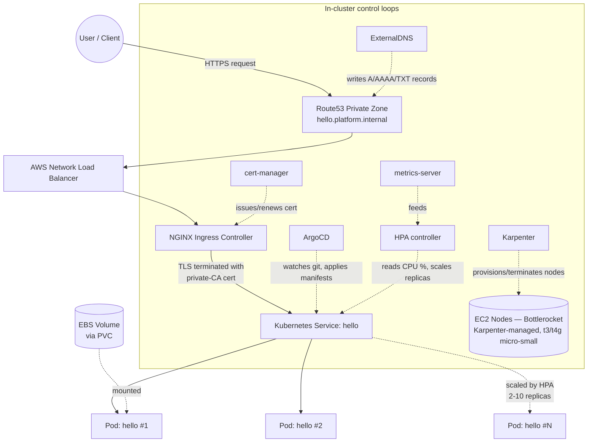
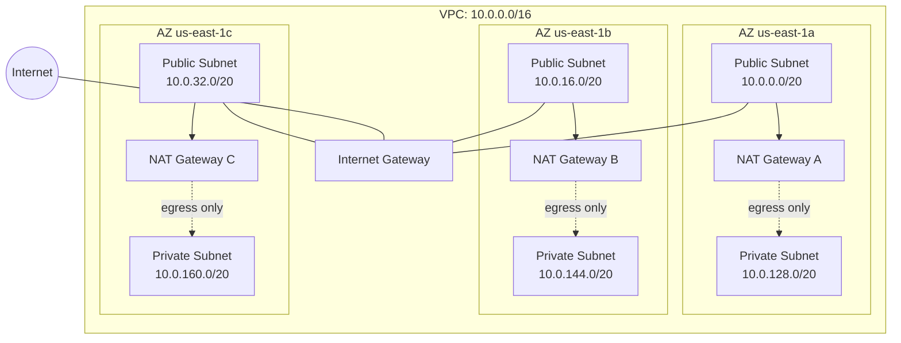

# Architecture

## High-Level Design (HLD)

## Low-Level Design (LLD) — Network Topology

**Why per-AZ NAT, not shared:** if a single AZ's NAT Gateway serves all three AZs and that AZ has an outage, all three AZs lose outbound connectivity — not just the one that's actually down. Per-AZ NAT means a single-AZ outage only ever affects that one AZ's egress. See ADR-001.

## Traffic Flow — Request Lifecycle

1. Client resolves `hello.platform.internal` via the private Route53 zone (only resolvable from inside the VPC, or via explicit DNS override for testing).
2. Request hits the AWS Network Load Balancer, provisioned automatically by the NGINX Ingress Controller's `Service`.
3. NLB forwards to a healthy NGINX Ingress Controller pod (health-checked).
4. Ingress Controller terminates TLS using a certificate issued by the platform's private CA (`cert-manager`), matches the `Host` header against configured `Ingress` rules.
5. Traffic is proxied to the matching Kubernetes `Service`, then load-balanced across healthy backend Pods via `kube-proxy`/`iptables`.
6. Response returns the same path in reverse.

**NetworkPolicy intent (enforcement NOT VERIFIED):** between step 5 and the Pod — only traffic originating from the `ingress-nginx` namespace, on port 80, is permitted into the `hello` app's pods. All other ingress traffic to those pods is denied by default (`default-deny-ingress`).

## Failure Points — Explicit Enumeration

| Component | Failure mode | Blast radius | Mitigation |
|---|---|---|---|
| Single AZ outage | NAT Gateway, subnet, or nodes in that AZ become unreachable | That AZ's workloads only, if pods are spread across AZs | 3 AZs, 3 NAT Gateways, pod anti-affinity not yet configured (see gaps) |
| EKS control plane | AWS-managed; extremely rare outage | Cluster-wide — no workaround at this layer, accepted as AWS's SLA responsibility | Multi-AZ control plane is AWS-managed by default |
| Node failure | Pod(s) on that node become unavailable | Limited to pods scheduled on that node until rescheduled | Kubernetes reschedules automatically; Karpenter can provision a replacement node; proven live (see TESTING_AND_VALIDATION.md) |
| ArgoCD unavailable | New git changes stop deploying | No impact to already-running workloads — this is a control-plane-for-changes failure, not a data-plane failure | selfHeal/prune still function once ArgoCD recovers |
| Single shared EKS cluster (multi-env) | Cluster-wide incident affects dev, staging, AND prod simultaneously | All three environments | Explicitly accepted trade-off, see ADR-003 |
| Private CA compromise | Any cert issued by this CA becomes untrustworthy | All TLS traffic in the platform | Root CA secret (`platform-ca-secret`) access restricted to `cert-manager` namespace via standard Kubernetes RBAC; no external distribution |
| `terraform-cli` credential compromise | Full AWS account admin access | Entire AWS account | Deliberately deferred risk, see ADR-008; billing alerts as compensating control |

## Stress Conditions Discovered

**Load level tested:** 6 concurrent pods each requesting 1 vCPU, deliberately exceeding the 2-node system capacity (~4 vCPU total, much of it already committed to system pods).

**Bottleneck discovered:** not CPU or memory — **pods-per-node ceiling**. `t3.small`/`t4g.small` instances support only ~11 pods each due to AWS's ENI-based IP address allocation limit per instance type, independent of actual CPU/memory headroom. This surfaced as pods stuck `Pending` with no CPU/memory pressure visible anywhere — the real constraint was IP address slots, not compute. See `docs/CAPACITY_AND_COST.md` for the full capacity table by instance type.

**What this means operationally:** capacity planning for this platform must account for pods-per-node limits explicitly, not just aggregate CPU/memory — a workload profile with many small, low-resource pods will hit this ceiling before it hits a compute ceiling.

